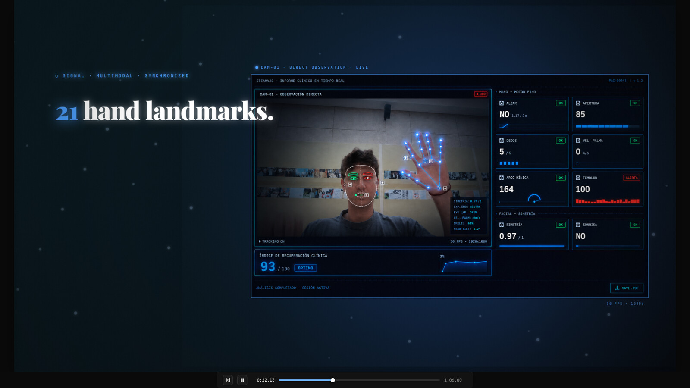
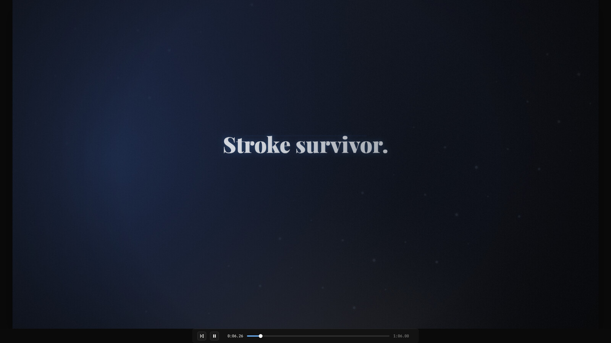
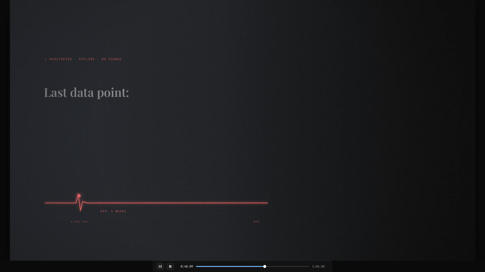

# Between Visits demo

A 60-second motion graphics product demo for Between Visits, written as a set of React components that animate a 1920x1080 stage in the browser.



## What it is

Between Visits is a pitch for post-stroke rehabilitation monitoring at home: the patient plays a short webcam game (SteadyArc), computer vision pulls clinical markers out of the hand, face, gaze and voice, and a report goes to the neurologist or rehab team. This repo is only the demo video for that pitch, not the product.

The demo is built as code instead of in a video editor: every block is a React component (or a canvas render function) driven by a shared timeline, so timings and copy can be tweaked and replayed in the browser. It was made in May 2026.

## How it works

- `animations.jsx` is a small timeline framework: a `Stage` with play/pause, scrubber and keyboard control (space, left/right arrows, 0 to reset), `Sprite` components that exist between two timestamps, and easing helpers.
- The composition is 7 blocks over 60 seconds (66 with buffer): the problem, the product, clinical observation, the report, comparison with the traditional follow-up, the care team, and the close.
- `between-visits-canvas.html` draws everything on a 2D canvas (`canvas-engine.jsx` plus `canvas-block1..7.jsx`): kinetic typography, count-ups, atmospheres, grain and glitch transitions, with three product screenshots dropped in.
- `between-visits-scenes.html` is the DOM version of the same script (`scenes-block1..7.jsx`), built around cropped product screenshots shown inside framed "monitor" viewports.
- `record.html` is the canvas version with React in production mode, no loop and no autoplay, meant to be opened full screen and screen recorded.





## Stack

Plain HTML, React 18 and Babel standalone from unpkg (JSX is compiled in the browser), Canvas 2D, Google Fonts (Playfair Display, JetBrains Mono, Inter). No build step, no npm.

## Run it

The JSX files are fetched by Babel at runtime, so the folder has to be served over HTTP (opening the file directly does not work in most browsers).

```
python3 -m http.server 8000 --bind 127.0.0.1
```

Then open:

- http://127.0.0.1:8000/between-visits-canvas.html for the canvas version (press space to play)
- http://127.0.0.1:8000/between-visits-scenes.html for the screenshot version
- http://127.0.0.1:8000/record.html to record (press F11 or your browser's full screen, start a screen recorder, press space)

Playback position is saved in localStorage, so a reload resumes where you left it; press 0 to go back to the start.
